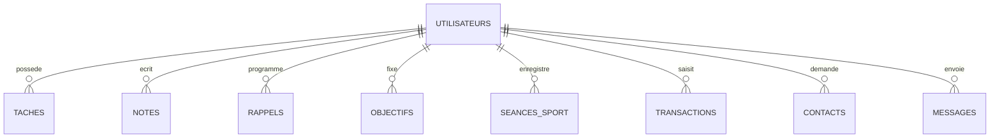

# Assistant personnel

**Une application web pour organiser son quotidien et communiquer, dans un seul outil.**

---

## Le projet

### Le problème

Au quotidien, on jongle entre plusieurs applications : une pour les listes de tâches, une pour les notes, une autre pour le sport, une autre pour le budget, et encore une autre pour discuter. Les informations sont dispersées et rien n'est relié.

### L'idée

Créer **un assistant personnel unique**, sous forme d'application web, qui regroupe tout au même endroit. Chaque utilisateur se connecte avec son compte et retrouve son espace personnel :

- **Organiser sa journée** : tâches avec priorité et échéance, notes classées par tags, rappels datés.

- **Suivre sa progression** : séances de sport, revenus et dépenses, objectifs chiffrés avec avancement en pourcentage.

- **Rester motivé** : un système de points et de niveaux récompense les objectifs atteints.

- **Communiquer** : les utilisateurs peuvent s'ajouter en contacts et s'envoyer des messages.

- **Tout voir d'un coup d'œil** : un tableau de bord rassemble les tâches du jour, les prochains rappels et les graphiques de suivi.

## La base de données

Le schéma complet est écrit en SQL dans [`schema.sql`](schema.sql). Il contient **9 tables** :

| Table | Rôle |

|---|---|

| `utilisateurs` | Comptes : pseudo, mot de passe haché, points et niveau |

| `taches` | Tâches avec titre, catégorie, priorité (1 à 3), échéance et état |

| `notes` | Notes avec tags, option « privée », dates de création et de modification |

| `rappels` | Rappels avec texte, date et heure, et état fait / non fait |

| `objectifs` | Objectifs avec valeur cible, valeur actuelle, unité et points à gagner |

| `seances_sport` | Séances avec type, durée et distance |

| `transactions` | Revenus (montant positif) et dépenses (montant négatif) par catégorie |

| `contacts` | Demandes de contact entre utilisateurs, avec statut (en attente, accepté, refusé) |

| `messages` | Messages avec expéditeur, destinataire, date et état lu / non lu |

### Relations

Toutes les tables sont rattachées à l'utilisateur : chaque donnée appartient à un compte.

### Choix de conception

- **Clés étrangères avec suppression en cascade** : si un compte est supprimé, toutes ses données le sont aussi, sans laisser de données orphelines.

- **Contraintes de validité** (`CHECK`) : la priorité d'une tâche est comprise entre 1 et 3, un utilisateur ne peut pas s'envoyer un message ni se demander lui-même en contact, les états ne prennent que les valeurs prévues.

- **Unicité** : un pseudo est unique, et une même demande de contact ne peut pas être faite deux fois.

- **Index** : les requêtes les plus fréquentes (messages d'une conversation, rappels à venir, tâches par échéance) sont accélérées.

- **Mots de passe** : seul le hash est stocké, jamais le mot de passe en clair.

### Exemples de requêtes prévues

- Afficher les tâches du jour non terminées d'un utilisateur.

- Calculer les dépenses du mois par catégorie.

- Récupérer la conversation entre deux utilisateurs, dans l'ordre chronologique.

- Compter les messages non lus d'un utilisateur.

Ces requêtes sont écrites à la fin du fichier [`schema.sql`](schema.sql).

## Prochaines étapes

1. Créer les comptes utilisateurs avec une connexion sécurisée.

2. Développer les modules de base : tâches, notes, rappels.

3. Ajouter le suivi du sport, du budget et des objectifs.

4. Construire la messagerie et le tableau de bord.

5. Ajouter le chiffrement des notes privées et des messages.
