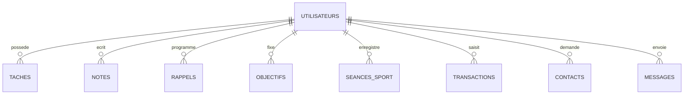

# Assistant personnel

**Tâches, notes, rappels, suivi du sport et du budget, messagerie : tout au même endroit.**

---

## À propos

Une application web pour organiser son quotidien dans un seul outil : gérer ses tâches, prendre des notes, suivre ses séances de sport et son budget, atteindre ses objectifs et échanger avec d'autres utilisateurs.

Le projet met l'accent sur une **base de données bien conçue** et sur la **sécurité** des données.

## Fonctionnalités

| Module | Description | Statut |
|---|---|---|
| Comptes | Inscription, connexion, mots de passe hachés | À venir |
| Tâches | Priorité, échéance, catégories, filtres | À venir |
| Notes | Recherche, tags, notes privées | À venir |
| Rappels | Alertes datées sur la page d'accueil | À venir |
| Sport | Séances, distances, graphiques de progression | À venir |
| Budget | Revenus, dépenses, totaux par catégorie | À venir |
| Objectifs | Suivi en pourcentage, points et niveaux | À venir |
| Messagerie | Contacts, conversations, lu / non lu | À venir |
| Tableau de bord | Vue d'ensemble de tous les modules | À venir |

## Base de données

Le schéma complet est dans [`schema.sql`](schema.sql).

Chaque table est liée à `utilisateurs` par une clé étrangère. Des contraintes `CHECK` garantissent la validité des données, et des index accélèrent les requêtes fréquentes.

## Sécurité

- Mots de passe hachés et salés (bcrypt)
- Requêtes SQL paramétrées contre les injections
- Chaque utilisateur n'accède qu'à ses propres données et conversations
- Chiffrement des notes privées, puis chiffrement de bout en bout des messages (prévu)
